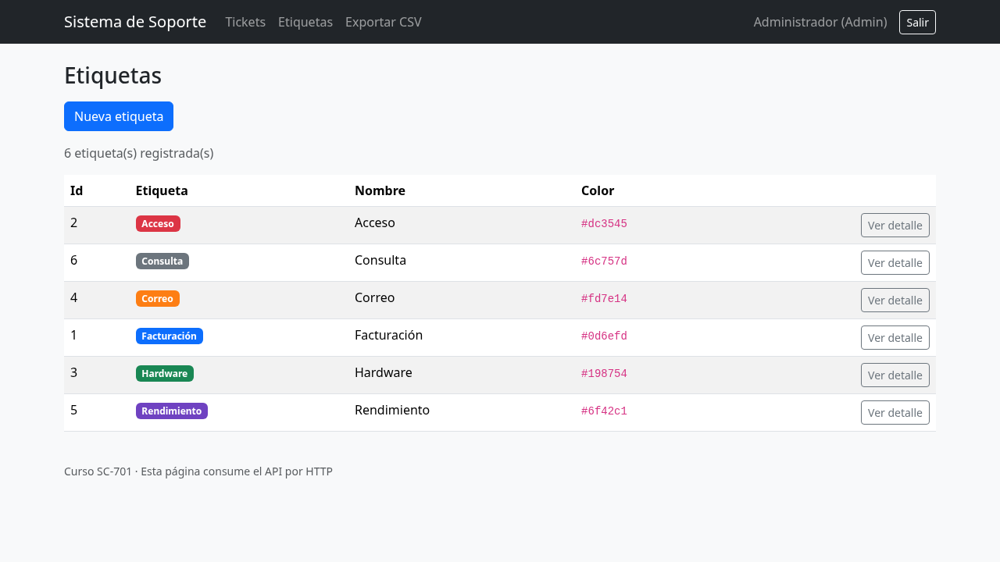
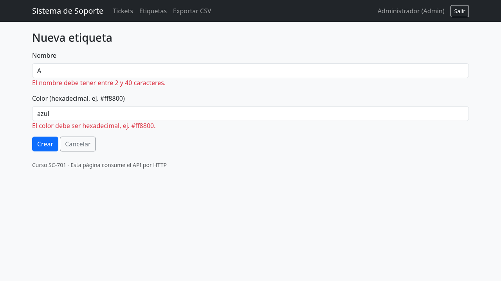
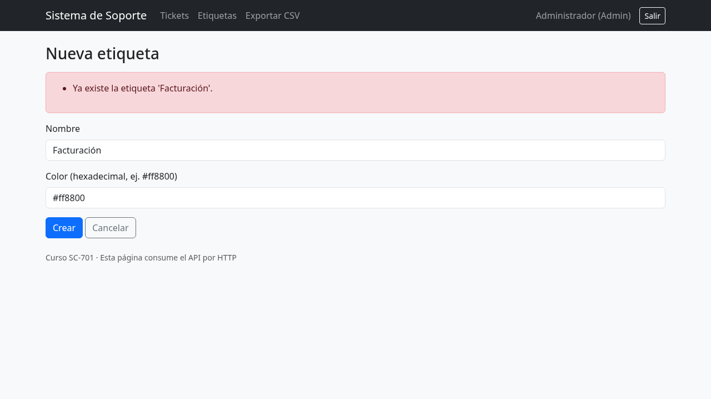

# Práctica Programada 3 – Etiquetas en el MVC

**Curso:** SC-701 Programación Avanzada Web (.NET)  
**Rama:** `practica3`

---

## Parte B: Investigación

### Pregunta 1. Post-Redirect-Get
El patrón **Post-Redirect-Get (PRG)** divide el procesamiento de un formulario en tres pasos: el navegador envía los datos mediante una petición `POST`, el servidor procesa la operación y responde con una redirección HTTP (`302 Found`) hacia una ruta de consulta, y el navegador realiza automáticamente un `GET` a esa nueva URL. Este patrón evita el problema concreto del reenvío accidental de formularios (duplicación de registros o transacciones) en el servidor. Si se omite y la acción `POST` devuelve directamente `View(creada)`, la última petición registrada por el navegador sigue siendo el `POST /Etiquetas/Crear`. En consecuencia, si el usuario presiona **F5** (recargar), el navegador volverá a enviar el mismo cuerpo `POST` al servidor, intentando crear la etiqueta por segunda vez (lo cual provocará un conflicto 409 o duplicará datos si no existiera restricción única). Con PRG, presionar F5 en la página de detalle solo repite un `GET /Etiquetas/Detalle/{id}` inofensivo e idempotente.
- **Fuente:** Microsoft Learn – *Model binding and Post-Redirect-Get in ASP.NET Core MVC*: https://learn.microsoft.com/en-us/aspnet/core/mvc/views/working-with-forms

### Pregunta 2. Cliente tipado
Cuando un cliente tipado como `EtiquetasApi` se registra mediante `AddHttpClient<IEtiquetasApi, EtiquetasApi>()`, el servicio se registra con tiempo de vida **Transient** (transitorio) en el contenedor de inyección de dependencias, mientras que `IHttpClientFactory` administra internamente un pool de instancias `HttpMessageHandler` que se reutilizan y rotan periódicamente. No conviene registrar el cliente tipado como **Singleton** porque retendría una única instancia de `HttpClient` y su handler durante toda la ejecución de la aplicación, impidiendo que detecte cambios en los registros DNS cuando un servidor cambia de dirección IP. Tampoco se debe instanciar `new HttpClient()` manualmente en cada petición porque cada instancia abre sockets TCP propios que no se liberan de inmediato al hacer `Dispose` (quedan en estado `TIME_WAIT`), lo que bajo carga provoca agotamiento de puertos (*socket exhaustion*). Usar `AddHttpClient` combina instancias ligeras del cliente con el reciclaje seguro de conexiones subyacentes.
- **Fuente:** Microsoft Learn – *Make HTTP requests using IHttpClientFactory in ASP.NET Core*: https://learn.microsoft.com/en-us/aspnet/core/fundamentals/http-requests

### Pregunta 3. ProblemDetails
**ProblemDetails** (definido en el estándar **RFC 9457**, que actualiza al RFC 7807) es un formato JSON estandarizado (`application/problem+json`) para que las APIs HTTP comuniquen errores de forma uniforme y legible por máquinas, evitando que cada servicio invente su propia estructura de error. En nuestro proyecto MVC, la clase `ApiException.ProblemaApi` lee tres campos del JSON devuelto por el API: `Title` (título general del tipo de problema), `Detail` (explicación específica de lo ocurrido) y `Errors` (diccionario `Dictionary<string, string[]>` con los mensajes de validación agrupados por propiedad). La diferencia entre ambos códigos radica en que un **400 Bad Request** de validación devuelve un `ValidationProblemDetails` que incluye el objeto `errors` con la lista de fallos por cada campo (`Nombre`, `Color`), los cuales el controlador asocia a cada input del formulario. En cambio, un **409 Conflict** devuelve un `ProblemDetails` simple con `status`, `title` y `detail` (por ejemplo, `"Ya existe la etiqueta 'Facturación'."`) sin el diccionario `errors`, por lo que el MVC lo muestra como un error general del modelo.
- **Fuente:** IETF RFC 9457 (*Problem Details for HTTP APIs*): https://www.rfc-editor.org/rfc/rfc9457 y Microsoft Learn – *Handle errors in ASP.NET Core APIs*: https://learn.microsoft.com/en-us/aspnet/core/web-api/handle-errors

### Pregunta 4. ValidateAntiForgeryToken
El atributo `[ValidateAntiForgeryToken]` previene los ataques de **Cross-Site Request Forgery (CSRF / XSRF)**, en los cuales un sitio web malicioso engaña al navegador de un usuario autenticado para que envíe una petición `POST` no deseada hacia nuestra aplicación aprovechando que el navegador adjunta automáticamente la cookie de sesión. ASP.NET Core lo previene aplicando el patrón *Synchronizer Token*: genera dos tokens criptográficos vinculados entre sí, uno almacenado en una cookie antifalsificación (`HttpOnly`) y otro insertado dentro del formulario HTML. En la vista Razor, el Tag Helper `<form method="post" asp-action="Crear">` inyecta automáticamente un campo oculto `<input name="__RequestVerificationToken" type="hidden" value="..." />`. Cuando llega el `POST`, `[ValidateAntiForgeryToken]` verifica que tanto la cookie como el campo oculto del formulario estén presentes y coincidan; como un sitio externo no puede leer el token del formulario por la política *Same-Origin*, el ataque es rechazado con HTTP 400.
- **Fuente:** Microsoft Learn – *Prevent Cross-Site Request Forgery (XSRF/CSRF) attacks in ASP.NET Core*: https://learn.microsoft.com/en-us/aspnet/core/security/anti-request-forgery

### Pregunta 5. ViewData, ViewBag, TempData y un modelo tipado
Un **modelo tipado** (`@model List<EtiquetaVm>` o `@model EtiquetaCrearVm`) pasa datos fuertemente tipados del controlador a la vista con verificación en tiempo de compilación e IntelliSense, siendo la opción principal para los datos de negocio de cada pantalla (como la lista de etiquetas en `Etiquetas/Index.cshtml`). **`ViewData`** es un diccionario débilmente tipado (`ViewDataDictionary` con claves `string`) y **`ViewBag`** es una envoltura `dynamic` sobre ese mismo `ViewData`; ambos viven únicamente durante la petición HTTP actual y son útiles para metadatos de diseño, como `ViewData["Title"] = "Etiquetas"` que la vista asigna para que `_Layout.cshtml` pinte el título de la pestaña. Por su parte, **`TempData`** almacena datos breves (respaldados por cookies o sesión) que sobreviven a una redirección HTTP y se borran tras leerse. En nuestra práctica usamos `TempData["Exito"] = $"Etiqueta '{creada.Nombre}' creada."` en el `POST` de `EtiquetasController.Crear` para que el mensaje verde de confirmación se muestre tras el `RedirectToAction(nameof(Detalle))`.
- **Fuente:** Microsoft Learn – *Views in ASP.NET Core MVC (Pass data to views)*: https://learn.microsoft.com/en-us/aspnet/core/mvc/views/overview#pass-data-to-views

---

## Evidencias

Las capturas de pantalla requeridas se encuentran en la carpeta `docs/evidencia/`:

1. **Evidencia 1 – Lista de etiquetas con la vista parcial `_InsigniaColor` funcionando:**  
   Archivo: `docs/evidencia/evidencia1-lista-etiquetas.png`  
   

2. **Evidencia 2 – Formulario con errores de validación debajo de los campos (`Nombre` y `Color`):**  
   Archivo: `docs/evidencia/evidencia2-error-validacion.png`  
   

3. **Evidencia 3 – Formulario con el mensaje de nombre repetido (HTTP 409 del API):**  
   Archivo: `docs/evidencia/evidencia3-error-duplicado-409.png`  
   

---

## Declaración de uso de herramientas de apoyo (Sección 9)

- **Herramienta utilizada:** Asistente de IA (Antigravity / Gemini).
- **Propósito de uso:** Diagnóstico inicial de la solución y conexión con SQL Server en contenedor local, apoyo en la estructuración del módulo MVC de Etiquetas (`EtiquetaVm`, `EtiquetaCrearVm`, `IEtiquetasApi`, `EtiquetasApi`, `EtiquetasController` y vistas Razor siguiendo el patrón de `Tickets`) y automatización de pruebas de flujo para la captura de evidencias. Todo el código y las respuestas de investigación fueron revisados y validados contra la arquitectura de 4 capas del curso.
